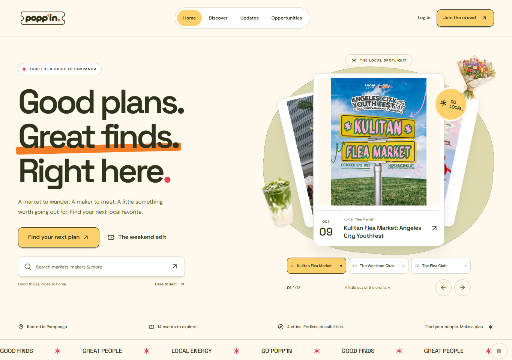
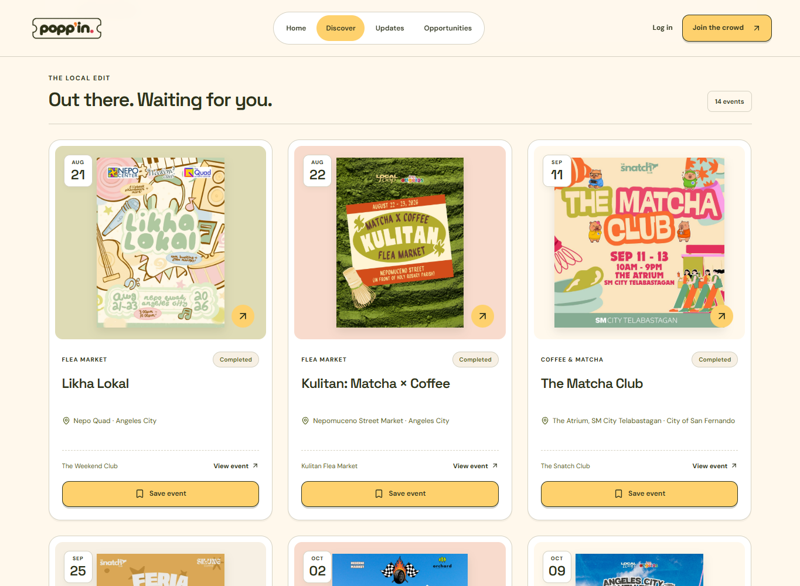
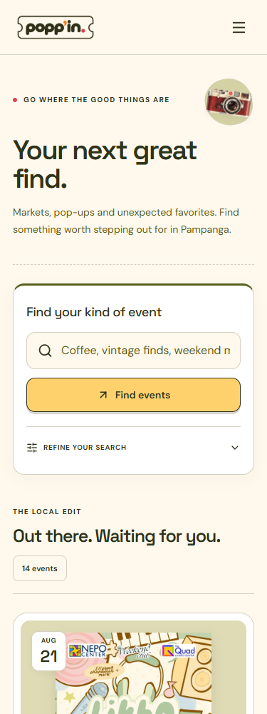

# Popp'in

Popp'in helps people discover pop-up markets and local businesses in Pampanga. Users can save events and apply as vendors, while organizers manage events, updates, and applications.

## Members and contributions

| Member | Contribution |
| --- | --- |
| Juliana | Backend, database, and MongoDB configuration. |
| Hannah | Frontend development and UI design. |
| Jolanne | Frontend development and UI improvements. |

## Features

- Event search and filters by location, category, date, and status.
- Saved events with completed/cancelled labels and removal confirmation.
- Organizer updates with scrollable galleries of up to 12 images.
- Event creation, editing, publishing, and cancellation.
- Vendor applications, organizer reviews, and available-space tracking.
- Account profiles, validated forms, and responsive layouts.

## Technology and data

The frontend in `client/` uses React, TypeScript, Vite, Tailwind CSS, React Router, React Hook Form, Zod, and Axios. The backend in `server/` uses Node.js, Express, Mongoose, MongoDB Atlas, JWT, and Cloudinary.

MongoDB stores users, organizer/vendor profiles, venues, categories, events, updates, vendor calls, applications, and saved events. The server filters events, calculates event status and remaining vendor spaces, prevents duplicate saves/applications, and validates publishing and application-review rules.

## Screenshots

**Home**



**Event discovery**



**Mobile**



## Setup

Requires Node.js 24, npm, Git, MongoDB Atlas (or a MongoDB replica set), and Cloudinary credentials for image uploads.

### 1. Install

```powershell
git clone https://github.com/Calypxo/Poppin.git
cd Poppin
npm ci --prefix server
npm ci --prefix client
if (!(Test-Path server/.env)) { Copy-Item server/.env.example server/.env }
if (!(Test-Path client/.env)) { Copy-Item client/.env.example client/.env }
```

### 2. Configure environment variables

| File | Variable | Value |
| --- | --- | --- |
| `server/.env` | `PORT` | `3000` |
| `server/.env` | `MONGO_URI` | Atlas connection string with the database name |
| `server/.env` | `CLIENT_ORIGIN` | `http://localhost:5173` |
| `server/.env` | `NODE_ENV` | `development` |
| `server/.env` | `JWT_SECRET` | A random private secret |
| `server/.env` | `CLOUDINARY_CLOUD_NAME` | Cloudinary cloud name |
| `server/.env` | `CLOUDINARY_API_KEY` | Cloudinary API key |
| `server/.env` | `CLOUDINARY_API_SECRET` | Cloudinary API secret |
| `server/.env` | `DEMO_PASSWORD` | Your chosen password for seeded accounts |
| `client/.env` | `VITE_API_URL` | `http://localhost:3000/api` |

Create an Atlas database user and allow your development IP in Atlas network access. Keep credentials in the ignored `.env` files.

### 3. Seed sample data

Use an empty demo database. Set `DEMO_PASSWORD` to at least 8 characters and at most 72 UTF-8 bytes, then run:

```powershell
npm --prefix server run seed
```

The seed creates accounts and sample event data and refuses to overwrite existing data. Sign in with the configured `DEMO_PASSWORD`:

| Account | Email |
| --- | --- |
| Explorer | `explorer@example.invalid` |
| Organizer | `kulitan@demo.com` |
| Vendor | `matchamama@example.com` |

### 4. Run

Run each command in a separate terminal from the repository root:

```powershell
npm --prefix server run dev
```

```powershell
npm --prefix client run dev
```

Frontend: `http://localhost:5173`. API: `http://localhost:3000/api`.

## API reference

Base URL: `http://localhost:3000/api`. JSON requests use `Content-Type: application/json`. Protected routes require `Authorization: Bearer <token>`.

Use actual MongoDB IDs in place of `<eventId>` and similar placeholders. Responses are shortened examples; `—` means no request body. Access is public, signed-in (Account), ownership-restricted (Owner), or dependent on publication status (Visibility).

### Common create-request examples

Table rows refer to these example JSON bodies. Replace IDs and contact details; choose dates appropriate to the demo and an open vendor call when applying.

**Event body**

```json
{"title":"Local Makers Market","description":"Food and local crafts in Pampanga.","venue":"<venueId>","categories":["<categoryId>"],"startDate":"2030-10-17","endDate":"2030-10-17","startTime":"10:00","endTime":"18:00"}
```

**Vendor call body**

```json
{"event":"<eventId>","title":"Local makers wanted","description":"Apply to join our market.","applicationStartDate":"2030-10-01T00:00:00+08:00","applicationDeadline":"2030-10-15T23:59:00+08:00","totalSlots":10,"boothFee":1000,"boothSize":"2m x 2m","requirements":["Business details"],"acceptedCategories":["<categoryId>"],"status":"open"}
```

**Application body**

```json
{"vendorCall":"<callId>","businessName":"Sample Coffee","category":"<categoryId>","products":"Coffee and pastries","contactNumber":"09171234567","email":"vendor@example.com","businessDescription":"A local coffee business","notes":"One booth, please."}
```

**Organizer profile body**

```json
{"businessName":"Sample Markets","description":"Community market organizer","city":"Angeles","contactNumber":"09171234567","email":"organizer@example.com"}
```

**Vendor profile body**

```json
{"businessName":"Sample Coffee","description":"Local coffee business","city":"Angeles","contactNumber":"09171234567","email":"vendor@example.com","category":"<categoryId>","products":"Coffee and pastries"}
```

### Accounts and profiles

| Method | Path | Purpose / access | Sample request | Sample response |
| --- | --- | --- | --- | --- |
| GET | `/health` | API health / Public | — | 200 `{"message":"Popp'in API is running!"}` |
| POST | `/auth/register` | Create account / Public | `{"name":"Demo User","email":"demo@example.com","password":"ReplaceWithYourPassword!"}` | 201 `{"token":"<jwt>","user":{"name":"Demo User"}}` |
| POST | `/auth/login` | Sign in / Public | `{"email":"demo@example.com","password":"ReplaceWithYourPassword!"}` | 200 `{"token":"<jwt>","user":{"name":"Demo User"}}` |
| GET | `/auth/me` | Current account / Account | — | 200 `{"_id":"<userId>","name":"Demo User"}` |
| GET | `/profiles/me` | Personal and business profiles / Account | — | 200 `{"user":{"name":"Demo User"},"organizer":null,"vendor":null}` |
| PATCH | `/profiles/me` | Edit personal profile / Account | `{"city":"Angeles"}` | 200 `{"user":{"city":"Angeles"}}` |
| POST | `/profiles/organizer` | Create organizer profile / Account | Organizer profile body above | 201 `{"organizer":{"name":"Sample Markets"}}` |
| PATCH | `/profiles/organizer` | Edit own organizer profile / Account | `{"city":"San Fernando"}` | 200 `{"organizer":{"city":"San Fernando"}}` |
| POST | `/profiles/vendor` | Create vendor profile / Account | Vendor profile body above | 201 `{"vendor":{"businessName":"Sample Coffee"}}` |
| PATCH | `/profiles/vendor` | Edit own vendor profile / Account | `{"products":"Coffee, pastries and tea"}` | 200 `{"vendor":{"products":"Coffee, pastries and tea"}}` |
| GET | `/organizers` | List active organizers / Public | — | 200 `[{"_id":"<organizerId>","name":"Sample Markets"}]` |
| GET | `/organizers/:id` | Organizer and public activity / Public | — | 200 `{"profile":{"name":"Sample Markets"},"events":[],"posts":[]}` |
| GET | `/vendors/:id` | Vendor and public confirmed events / Public | — | 200 `{"profile":{"businessName":"Sample Coffee"},"events":[],"posts":[]}` |
| GET | `/vendors/me/confirmed-events` | Events with accepted applications / Account | — | 200 `[{"_id":"<eventId>","title":"Local Makers Market"}]` |

### Events and saved events

| Method | Path | Purpose / access | Sample request | Sample response |
| --- | --- | --- | --- | --- |
| GET | `/events` | List published events / Public | — | 200 `[{"_id":"<eventId>","title":"Local Makers Market"}]` |
| GET | `/events/discover` | Search, filter, and calculate state / Public | Query: `?city=Angeles&state=upcoming` | 200 `{"count":1,"events":[{"eventState":"upcoming","daysUntilStart":7}]}` |
| GET | `/events/mine` | Owned events and management totals / Account | — | 200 `[{"managementStats":{"totalApplications":2,"pendingApplications":1,"acceptedVendors":1,"totalSlots":10,"remainingSlots":9}}]` |
| GET | `/events/public/:id` | Published event details / Public | — | 200 `{"_id":"<eventId>","status":"published"}` |
| GET | `/events/:id` | Event details / Visibility | — | 200 `{"_id":"<eventId>","title":"Local Makers Market"}` |
| GET | `/events/:id/vendors` | Accepted vendor lineup / Visibility | — | 200 `[{"_id":"<applicationId>","businessName":"Sample Coffee","products":"Coffee and pastries"}]` |
| POST | `/events` | Create draft / Account with organizer profile | Event body above | 201 `{"_id":"<eventId>","title":"Local Makers Market","status":"draft"}` |
| PATCH | `/events/:id` | Edit event / Owner | `{"title":"Local Makers Weekend"}` | 200 `{"_id":"<eventId>","title":"Local Makers Weekend"}` |
| PATCH | `/events/:id/status` | Publish or cancel with rules / Owner | `{"status":"published"}` | 200 `{"message":"Event published","event":{"status":"published"}}` |
| DELETE | `/events/:id` | Delete when no posts/calls reference it / Owner | — | 200 `{"message":"Event deleted"}` |
| GET | `/saved-events` | List own bookmarks / Account | — | 200 `[{"eventId":"<eventId>","savedAt":"2026-10-10T00:00:00.000Z","event":{"title":"Local Makers Market"}}]` |
| PUT | `/saved-events/:eventId` | Save without duplicates / Account | — | 201 (new) or 200 (already saved) `{"eventId":"<eventId>","saved":true}` |
| DELETE | `/saved-events/:eventId` | Remove own bookmark / Account | — | 200 `{"eventId":"<eventId>","saved":false}` |

### Updates and feed

The frontend uses `/posts`; every `/announcements` route below is also available with that prefix.

| Method | Path | Purpose / access | Sample request | Sample response |
| --- | --- | --- | --- | --- |
| GET | `/announcements` | Published posts on published events / Public | — | 200 `[{"_id":"<postId>","title":"Meet our merchants"}]` |
| GET | `/announcements/mine` | Posts on owned events / Account | — | 200 `[{"_id":"<postId>","isPublished":false}]` |
| GET | `/announcements/event/:eventId` | Event updates / Visibility | — | 200 `[{"_id":"<postId>","type":"lineup"}]` |
| GET | `/announcements/:id` | Post details / Visibility | — | 200 `{"_id":"<postId>","title":"Meet our merchants"}` |
| POST | `/announcements` | Create event update / Owner | `{"event":"<eventId>","title":"Meet our merchants","content":"Coffee and local finds.","type":"lineup","imageUrls":[],"isPublished":true}` | 201 `{"_id":"<postId>","type":"lineup","imageUrls":[]}` |
| PATCH | `/announcements/:id` | Edit text or replace gallery / Owner | `{"content":"Updated merchant list.","imageUrls":[]}` | 200 `{"_id":"<postId>","content":"Updated merchant list.","imageUrls":[]}` |
| DELETE | `/announcements/:id` | Delete update / Owner | — | 200 `{"message":"Post deleted"}` |
| GET | `/feed` | Merge, sort, and paginate activity / Public | Query: `?page=1` | 200 `{"items":[],"page":1,"hasMore":false,"count":0}` |
| POST | `/uploads/image` | Upload one JPG/PNG/WEBP, maximum 5 MB / Account | Multipart form: `image=<file>` | 201 `{"message":"Image uploaded successfully","secureUrl":"<cloudinaryUrl>","publicId":"poppin/events/example","width":800,"height":1000,"format":"jpg"}` |

For a multi-image post, upload each image, then send the returned URLs in order as `imageUrls`. A post accepts at most 12 distinct URLs.

### Vendor calls and applications

| Method | Path | Purpose / access | Sample request | Sample response |
| --- | --- | --- | --- | --- |
| GET | `/vendor-calls` | Active open calls with computed availability / Public | — | 200 `[{"_id":"<callId>","availability":{"status":"open","canApply":true}}]` |
| GET | `/vendor-calls/mine` | Calls on owned events / Account | — | 200 `[{"_id":"<callId>","title":"Local makers wanted"}]` |
| GET | `/vendor-calls/event/:eventId` | Latest open call on a published event / Public | — | 200 `{"_id":"<callId>","status":"open"}` or `null` |
| GET | `/vendor-calls/:id` | Call details / Visibility | — | 200 `{"_id":"<callId>","totalSlots":10,"boothFee":1000}` |
| GET | `/vendor-calls/:id/availability` | Capacity and eligibility window / Visibility | — | 200 `{"statistics":{"acceptedApplications":1,"slotsRemaining":9},"availability":{"status":"open","canApply":true}}` |
| POST | `/vendor-calls` | Create recruitment / Event owner | Vendor call body above | 201 `{"_id":"<callId>","title":"Local makers wanted","totalSlots":10}` |
| PATCH | `/vendor-calls/:id` | Edit recruitment without reducing capacity below occupancy / Owner | `{"totalSlots":12}` | 200 `{"_id":"<callId>","totalSlots":12}` |
| DELETE | `/vendor-calls/:id` | Delete call without applications / Owner | — | 200 `{"message":"Vendor call deleted"}` |
| GET | `/vendor-applications` | Own outgoing or owned-event incoming applications / Account | Query: `?view=incoming&event=<eventId>` | 200 `[{"_id":"<applicationId>","status":"pending"}]` |
| GET | `/vendor-applications/:id` | Application details / Applicant or event owner | — | 200 `{"_id":"<applicationId>","businessName":"Sample Coffee","status":"pending"}` |
| POST | `/vendor-applications` | Submit after eligibility/duplicate checks / Account | Application body above | 201 `{"_id":"<applicationId>","applicationCode":"POP-<uuid>","status":"pending"}` |
| PATCH | `/vendor-applications/:id/status` | Accept/reject pending application / Event owner | `{"status":"accepted","organizerRemarks":""}` | 200 `{"_id":"<applicationId>","status":"accepted"}` |
| PATCH | `/vendor-applications/:id` | Update notes or withdraw while pending / Applicant | `{"status":"withdrawn"}` or `{"notes":"Updated setup details"}` | 200 `{"_id":"<applicationId>","status":"withdrawn"}` or updated application |
| DELETE | `/vendor-applications/:id` | Delete pending/withdrawn application / Applicant | — | 200 `{"message":"Application deleted"}` |

### Venues and categories

| Method | Path | Purpose / access | Sample request | Sample response |
| --- | --- | --- | --- | --- |
| GET | `/venues` | List venues / Public | — | 200 `[{"_id":"<venueId>","name":"Sample Plaza"}]` |
| GET | `/venues/:id` | Venue details / Public | — | 200 `{"_id":"<venueId>","city":"Angeles"}` |
| POST | `/venues` | Create venue / Account | `{"name":"Sample Plaza","address":"Sample Street","city":"Angeles","venueType":"Outdoor Market"}` | 201 `{"_id":"<venueId>","name":"Sample Plaza"}` |
| PATCH | `/venues/:id` | Edit venue / Creator | `{"description":"Covered outdoor area"}` | 200 `{"_id":"<venueId>","description":"Covered outdoor area"}` |
| DELETE | `/venues/:id` | Delete unreferenced venue / Creator | — | 200 `{"message":"Venue deleted successfully"}` |
| GET | `/categories` | List categories / Public | — | 200 `[{"_id":"<categoryId>","name":"Local Crafts"}]` |
| GET | `/categories/:id` | Category details / Public | — | 200 `{"_id":"<categoryId>","name":"Local Crafts"}` |
| POST | `/categories` | Create unique category / Account | `{"name":"Local Crafts","description":"Handmade goods"}` | 201 `{"_id":"<categoryId>","name":"Local Crafts"}` |
| PATCH | `/categories/:id` | Edit category / Creator | `{"description":"Handmade local products"}` | 200 `{"_id":"<categoryId>","description":"Handmade local products"}` |
| DELETE | `/categories/:id` | Delete unreferenced category / Creator | — | 200 `{"message":"Category deleted successfully"}` |

Successful reads, updates, and deletes normally return 200; creates return 201. Errors use `{"message":"..."}`, with optional validation details. Invalid data/IDs return 400, unauthenticated requests 401, forbidden changes 403, missing records 404, conflicts 409, and unexpected server errors 500. Unconfigured sign-in returns 503.

## Known limitations

- Social-media highlights are added manually; there is no automatic social-media sync.
- Payments, email notifications, and password resets are not included.
- Event status uses calendar dates in Asia/Manila; seeded dates are fixed in October 2026.
- Only the feed is paginated, and it currently loads matching records before pagination.
